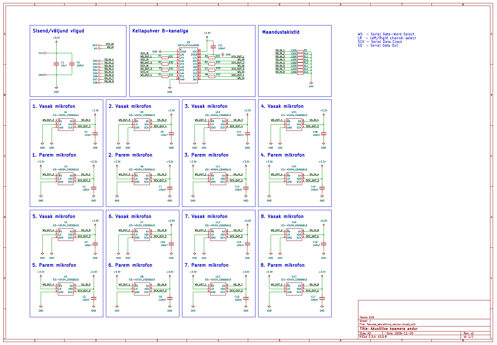
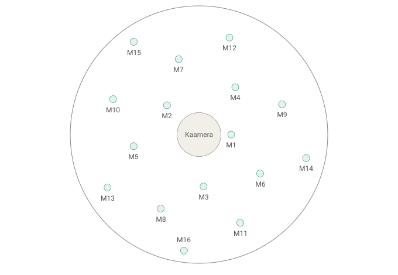

# Akustilise kaamera projekt

## Andur

- 16 mikrofoni
- Mikrofonid on paigutatud päevalillespiraali (Vogeli spiraal).
- Jaotuvad ühtlaselt üle pinna ja ükski vahekaugus ei kordu.

### Koordinaadid

Nullpunkt on kaamera ava keskel, mõõdud millimeetrites mikrofoni heliava keskkohani. Sisemine raadius on 22 mm ja välimine 80 mm.

Mikrofon|x	  |y	
--------|-----|-----
M1	    | 22,0|  0,0	
M2	    |−21,9| 20,0	
M3	    |  3,1|−35,5
M4	    | 24,8| 32,4	
M5	    |−44,7| −7,9	
M6	    | 41,8|−26,6
M7	    |−13,9| 51,6
M8	    |−26,2|−50,6
M9	    | 56,7| 20,7
M10	    |−58,7|	24,2
M11	    | 28,2|−60,3
M12	    | 20,8|	66,3
M13	    |−62,5|−36,2
M14	    | 73,2|−16,1
M15	    |−44,6|	63,4
M16	    |−10,3|−79,3

